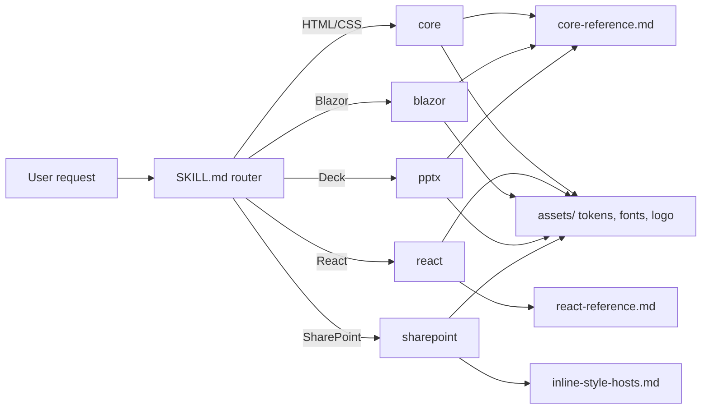

# Architecture Overview

This repository packages the official **B.C. Government Design System** (tokens v5, components v0.7, BC Sans, WCAG 2.1 AA rules) as **one APM skill**, `bc-gov-design-system`, with five modes. There is no plugin wrapper: primitives live in `.apm/skills/` at the repository root, the skill is self-contained, and nothing is symlinked.

## 1. Directory structure

```text
claude-design-bc-gov-design-system/
├── apm.yml                                   # APM package manifest (v2.0.0)
├── .apm/skills/bc-gov-design-system/
│   ├── SKILL.md                              # Router: picks the mode
│   ├── references/
│   │   ├── modes/                            # core, react, blazor, pptx, sharepoint playbooks
│   │   ├── core-reference.md                 # Full token and component patterns
│   │   ├── react-reference.md                # React component patterns
│   │   ├── inline-style-hosts.md             # Hosts that strip <style> (SharePoint, CMS, email)
│   │   ├── brand-foundations.md              # Voice, layout, state and motion rules
│   │   └── acceptance-<mode>.md              # Per-mode acceptance criteria
│   ├── assets/                               # colors_and_type.css, BC Sans fonts, logo, generate.js, examples/ (UI kit, previews)
│   └── evals/evals.json                      # Trigger evals (root array, should_trigger)
├── README.md
├── INSTALL.md                                # Global and project-local APM install
├── architecture.md                           # This overview
├── AGENTS.md / CLAUDE.md                     # Agent rules (CLAUDE.md bridges to AGENTS.md)
```

## 2. Modes

| Mode | Target | Playbook |
|---|---|---|
| `core` | Static HTML/CSS, tokens, headers, footers, forms, alerts | `references/modes/core.md` |
| `react` | React / Next.js with `@bcgov/design-system-react-components` | `references/modes/react.md` |
| `blazor` | Blazor Server or WASM, Razor | `references/modes/blazor.md` |
| `pptx` | PowerPoint decks via `assets/generate.js` | `references/modes/pptx.md` |
| `sharepoint` | SharePoint Online pages, text web parts, static HTML in libraries, shared assets | `references/modes/sharepoint.md` |



## 3. Design decisions

- **One skill, modes in references.** The four former skills (core, react, blazor, pptx) became mode playbooks, plus a new `sharepoint` mode; their content was preserved. The router stays under 100 lines.
- **Self-contained.** Fonts and logo are real files inside `assets/`; `colors_and_type.css` is the canonical token file.
- **APM-native.** Install with `apm install`; see [INSTALL.md](INSTALL.md). Deployed copies in `.agents/`, `.claude/` and similar are generated and git-ignored.
- **Project-specific rules stay out.** Consumer repositories (for example `jag-csb-intranet`) own their division headers, link maps and publish commands.

## 4. Verification

```bash
python3 <path-to-packaging-with-apm>/scripts/validate_apm_package.py --path .
python3 <path-to-authoring-skills>/scripts/audit_skill.py .apm/skills/bc-gov-design-system --mode source
```

Each mode is checked against its `references/acceptance-<mode>.md`.
